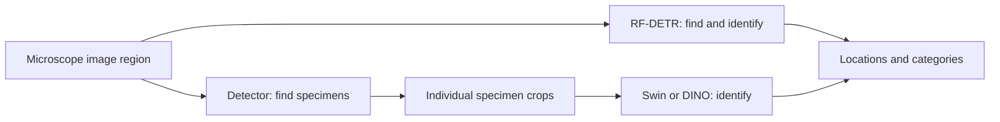

# Fossil pollen detection and classification

This project helps researchers locate fossil pollen in microscope images and
identify its category. Identifying pollen provides evidence about past vegetation;
manually finding and naming specimens requires expert time.

**Start with the [first-run walkthrough](docs/QUICKSTART.md).** It takes you from a
fresh checkout to inspecting the supplied results, then running a classifier on a
real specimen. The first part needs no data access, model weights, or GPU.

For the two-stage workflow, see [RF-DETR + Swin / DINOv2](method_b/README.md).

## What the software does

| Approach | Input → processing → output | Code |
| --- | --- | --- |
| **Find and identify together** | Image region → RF-DETR → boxes and category predictions | [RF-DETR workflow](docs/WORKFLOWS.md#rf-detr-method-a) |
| **Find first, identify second** | Image region → detector → specimen crops → Swin or DINO → category predictions | [Combined inference](docs/WORKFLOWS.md#small-detector-to-classifier-example) |

Swin and DINO are alternative classifiers. They identify the category of a cropped
specimen; they do not locate specimens across an entire microscope slide.

The code includes preparation, training, validation, and inference. Small demos
accept PNG/JPEG regions or crops. Full NDPI-slide workflows require additional
external data and the documented runtime; they are not a single plug-and-play app.

## Choose where to start

| What you want to do | What you need | Start here |
| --- | --- | --- |
| Inspect results and check the code | Python 3.13 and Git | [No-data walkthrough](docs/QUICKSTART.md#1-check-the-repository-and-view-results) |
| Classify one real specimen | CPU environment, crop bundle, Swin checkpoint | [Swin example](docs/QUICKSTART.md#2-run-swin-on-a-real-specimen) |
| Compare DINO on the same specimen | DINO checkpoint and pinned source checkout | [DINO example](docs/QUICKSTART.md#3-compare-dino-on-the-same-crop) |
| Detect and classify an image region | Detector runtime and matching weights | [Combined inference](docs/WORKFLOWS.md#small-detector-to-classifier-example) |
| Reproduce an evaluation or training run | Frozen data, configurations, checkpoints; GPU for training | [Results-to-command guide](docs/RESULTS.md) |

## What the current results mean

The completed **28-category classifier comparison** uses expert-located specimen
crops. These are validation accuracies:

| Classifier | Unseen-slide validation | Shared-slide validation |
| --- | ---: | ---: |
| Swin-Tiny | 42.94% | 70.61% |
| Partially fine-tuned DINO | 50.14% | 74.35% |

“Unseen slides” keeps source groups out of training. “Shared slides” uses different
specimens but allows training and validation examples from the same slides.
Neither column measures whole-slide detection accuracy. The final test set is
reserved. See [evaluation definitions](docs/METHODS.md) and
[result reproduction](docs/RESULTS.md) for the separate detector and combined results.

## Where the data live

Git contains code, category maps, and small aggregate results. Original images,
prepared crops, and trained weights are stored externally in the Rice project
allocation. **Public GitHub access does not grant access to those files.**

The [data guide](docs/DATA.md) explains account access, exact file locations,
checkpoint verification, and path configuration. The first-run walkthrough downloads
only the prepared crop bundle and selected checkpoint, not whole microscope slides.

## Repository map

| Location | Purpose |
| --- | --- |
| `method_b/classification/predict_categories.py`, `method_b/detection/predict_boxes.py` | Small image/crop inference entry points |
| `method_b/preprocessing/`, `method_b/classification/` | Focal-plane preparation and Swin/DINO training |
| `scripts/method_a/`, `scripts/method_a_focus_stack_v1/` | RF-DETR data variants and baseline reproduction |
| `method_b/pipeline/`, `method_b/evaluation/` | Detector/classifier handoff and evaluation |
| `config/`, `data/`, `examples/` | Path templates, checkpoint hashes, category maps, example identities |
| `results/`, `reports/` | Aggregate evidence used to regenerate tables and figures |
| `tests/`, `provenance/` | Regression checks and source/file fingerprints |

## Further instructions

- [First-run walkthrough and troubleshooting](docs/QUICKSTART.md)
- [Data, weights, and source dependencies](docs/DATA.md)
- [Workflow commands and reusable interfaces](docs/WORKFLOWS.md)
- [Results-to-command guide](docs/RESULTS.md)
- [Scientific protocol](docs/METHODS.md)
- [What has been tested](VALIDATION.md)
- [Source attribution](NOTICE.md)

The setup was checked on Linux with Python 3.13. Model demos run on CPU; training
requires the documented GPU environment. Use a new output location for each run.
