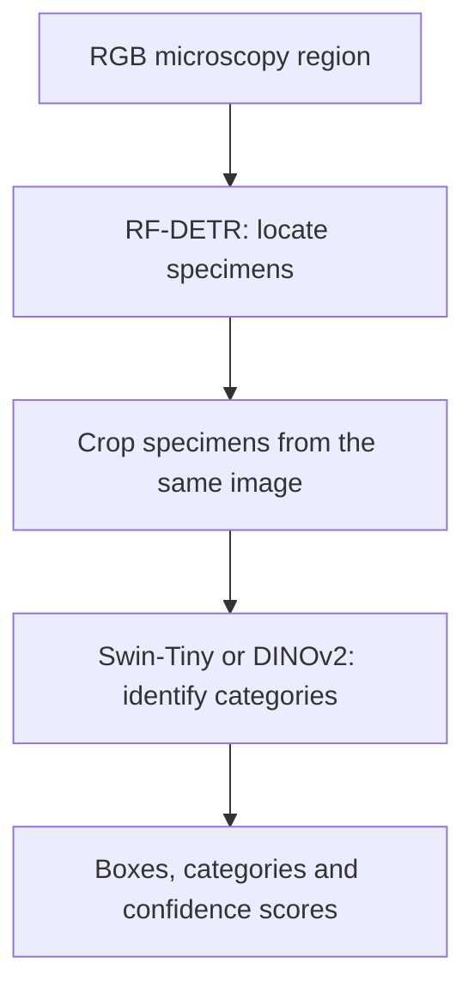

# RF-DETR + Swin-Tiny / DINOv2

Method B first locates fossil pollen specimens with RF-DETR, then classifies each
detected specimen using Swin-Tiny or DINOv2 ViT-B/14. Locating and identifying
specimens in large multifocal images requires expert time; this workflow examines
how these two tasks can be automated and evaluated separately.

All commands below run from the repository root. Start with the notebook for a
results walkthrough, or use the command-line examples with authorized model inputs.

## Pipeline



Full NDPI workflows first extract image regions and select or combine focal planes.
Focal processing differs across recorded experiments. The classifier handoff keeps
the detector's RGB pixels, adds 10% context, pads to a white square, resizes to
224 by 224 using bicubic interpolation, and applies ImageNet normalization.
The command-line key `dino` refers to DINOv2.

## File structure

| Folder | Main modules | Responsibility |
| --- | --- | --- |
| `preprocessing/` | `select_focal_plane.py`, `prepare_specimen_crops.py`, `prepare_detection_tiles.py` | Focal-plane selection, classifier crops and detector tiles |
| `preprocessing/` | `category_mapping.py`, `data_splits.py` | Fine-to-broad labels and recorded split assignments |
| `classification/` | `train_swin.py`, `train_dinov2.py` | Classifier training |
| `classification/` | `load_classifier.py`, `predict_categories.py`, `crop_dataset.py` | Frozen model loading, crop inference and training image datasets |
| `detection/` | `train_rfdetr.py`, `predict_boxes.py` | Single-class detector training and region inference |
| `pipeline/` | `crop_detected_specimens.py`, `detect_and_classify.py` | Same-image cropping and reusable region-to-category inference |
| `pipeline/` | `reference_slide_pipeline.py` | Preserved historical full-slide reference adapter |
| `evaluation/` | `evaluate_classifiers.py`, `evaluate_pipeline.py`, `classification_metrics.py` | Classifier and known-target pipeline evaluation |
| `evaluation/` | `compare_swin_dinov2.py`, `compare_rgb_bgr_inputs.py`, `export_results.py` | Fixed-detection comparisons, historical channel diagnostic and recorded tables |
| `utils/` | `file_io.py`, `input_validation.py` | Artifact I/O, source snapshots and frozen-input verification |
| `reference/Smithsonian_Fossil_Sp26/` | `focus_fusion.py`, `detection_merging.py`, `detection_types.py` | Attributed reference algorithms and structures |
| `notebooks/` | `demo.ipynb` | Guided results and optional inference demo |
| `tests/` | `test_predict_categories.py`, `test_pipeline_cli.py`, contract checks | Input, inference and pipeline regressions |

Paths in this table are relative to `method_b/`. Models and generated outputs are
external to this package. Root `scripts/infer.py` and `scripts/detect.py` remain
small compatibility entry points; their implementations live in this package.

## Data and checkpoints

NDPI contains multifocal slide images; NDPA contains expert annotation geometry
and labels. The adopted classification inventory contains 2,283 specimens:
1,605 training, 347 validation and 331 reserved test records.

The broad experiment maps the original 32 labels to 28 explicit groups by grouping
four Momipites labels and two Caryapollenites labels. Original fine labels are
retained. Separate-slide validation keeps source groups out of training;
shared-slide validation permits different specimens from the same slides across
training and validation. The final test specimens remain reserved.

Images and weights are external. Repository access does not grant access to them.
Use the [data guide](../docs/DATA.md) for authorized inputs, checkpoint fingerprints,
pinned DINOv2/Spring source, and path configuration. Classifier inventory counts
differ from the 274 covered targets in the fixed detector-crop diagnostic.

## Install

The documented environment is Linux / Python 3.13. CPU inference is sufficient for
the small demo. Training and full fixed-detection replay require the recorded GPU setup.

```bash
git clone https://github.com/PatrickBats/Smithsonian_software_review.git
cd Smithsonian_software_review
python3.13 -m venv .venv
source .venv/bin/activate
python -m pip install torch==2.10.0 torchvision==0.25.0 --index-url https://download.pytorch.org/whl/cpu
python -m pip install -r method_b/requirements.txt
python -m pip check
```

For GPU execution, select the corresponding CUDA PyTorch wheels instead of the CPU
wheels. `method_b/requirements.txt` is the dependency entry point for this package.

## Demo notebook

```bash
jupyter lab method_b/notebooks/demo.ipynb
```

Default cells inspect included classifier results and regenerate Method B tables
without loading weights. Optional sections classify a real RGB specimen or run
RF-DETR followed by classification. Set the paths before enabling `RUN_CLASSIFIER`
or `RUN_PIPELINE`. The notebook does not launch training or evaluate the test set.

## Predict categories on a specimen crop

```bash
python -m method_b.classification.predict_categories --model swin --checkpoint /path/to/swin/best.pt --image /path/to/specimen.png --device cpu --output outputs/swin_prediction.json
python -m method_b.classification.predict_categories --model dino --checkpoint /path/to/dino/best.pt --dino-source /path/to/dinov2 --image /path/to/specimen.png --device cpu --output outputs/dino_prediction.json
```

Use a verified project checkpoint listed in `config/checkpoints.json` and a fresh
output path. Output probabilities follow the checkpoint's stored class order.

## Detect and classify an image region

```bash
python -m method_b.pipeline.detect_and_classify --image /path/to/region.png --detector-checkpoint /path/to/detector.pth --detector-sha256 RECORDED_DETECTOR_SHA256 --classifier-checkpoint /path/to/swin/best.pt --model swin --device cpu --output outputs/region_prediction
```

Replace example paths and the hash with authorized inputs. For DINOv2, use its
checkpoint with `--model dino --dino-source /path/to/dinov2`. The output directory
contains detector artifacts in `detection/` and categories in `classifications.json`.
Boxes use region-local xyxy pixel coordinates. This command processes one region;
whole-slide evaluation additionally needs tiling, merging and reference matching.

For separate detector inference:

```bash
python -m method_b.detection.predict_boxes --checkpoint /path/to/detector.pth --sha256 RECORDED_DETECTOR_SHA256 --image /path/to/region.png --classes 1 --device cpu --output outputs/detection
```

## Prepare, train and evaluate

| Stage | Module to run with `python -m` |
| --- | --- |
| Export best-plane specimen crops | `method_b.preprocessing.prepare_specimen_crops` |
| Export detector tiles | `method_b.preprocessing.prepare_detection_tiles` |
| Train Swin-Tiny | `method_b.classification.train_swin` |
| Partially fine-tune DINOv2 | `method_b.classification.train_dinov2` |
| Train the single-class detector | `method_b.detection.train_rfdetr` |
| Replay classifier validation | `method_b.evaluation.evaluate_classifiers` |
| Evaluate detector-to-Swin handoff | `method_b.evaluation.evaluate_pipeline` |
| Replay fixed-detection classifier comparison | `method_b.evaluation.compare_swin_dinov2` |

Use the [workflow guide](../docs/WORKFLOWS.md) for complete arguments and external
prerequisites. `select_focal_plane.py` is an extraction worker invoked by the crop
orchestrator with specimen records; it is not a standalone command-line program.

Training validates frozen input identities and selects classifier checkpoints by
validation macro-F1. A new run retains the historical snapshot filenames and a
`source/method_b/` bundle containing its package dependencies. Fixed-detection replay
retains tile hashes, float32 coordinate arithmetic, precision settings and strict
Swin prediction checks. The reference source and historical external artifact paths
must remain available for those replay workflows.

## Recorded results

Expert-located crops, 28-group classification:

| Classifier | Separate-slide accuracy | Shared-slide accuracy |
| --- | ---: | ---: |
| Swin-Tiny | 42.94% | 70.61% |
| Partially fine-tuned DINOv2 | 50.14% | 74.35% |

Fixed detector-crop diagnostic:

| Metric | Swin-Tiny | DINOv2 |
| --- | ---: | ---: |
| Known targets | 274 | 274 |
| Matched detections | 258 | 258 |
| Correct classifications | 93 | 125 |
| Accuracy among matched detections | 36.0% | 48.4% |
| End-to-end success among known targets | 33.9% | 45.6% |

The diagnostic reuses existing checkpoints and the same crops. All 1,777 saved Swin
candidate labels were replayed against the corrected baseline. The detector saw
13/14 validation slides during original training, so these are diagnostic results.
Unmatched candidates are unreviewed where scene annotation is incomplete.

Regenerate only the Method B tables:

```bash
python -m method_b.evaluation.export_results --output outputs/method_b_tables
```

See [evaluation definitions](../docs/METHODS.md) for denominators and limitations.

## Software checks

```bash
python scripts/check_repository.py
python -m unittest discover -s tests -v
python -m unittest discover -s method_b/tests -v
```

These are software checks, not model retraining or benchmark reproduction. See
[VALIDATION.md](VALIDATION.md) for what was executed and the remaining limits.

## References

- [RF-DETR](https://github.com/roboflow/rf-detr), with the recorded RF-DETR+ 2XL dependency.
- [Swin Transformer, Liu et al.](https://arxiv.org/abs/2103.14030), using [torchvision](https://github.com/pytorch/vision).
- [DINOv2, Oquab et al.](https://arxiv.org/abs/2304.07193), using [Meta's source](https://github.com/facebookresearch/dinov2), revision `7764ea0f912e53c92e82eb78a2a1631e92725fc8`.
- [Smithsonian_Fossil_Sp26](https://github.com/RiceD2KLab/Smithsonian_fossil_Sp26), revision `1b62b68a0d95178e6275ef55c38ee4765317b334`, for the attributed focus fusion, merging and tile structures.

The reference algorithms are grouped under `reference/Smithsonian_Fossil_Sp26/`;
their original numerical routines and source credit are preserved. See the root
[NOTICE](../NOTICE.md) and import provenance for attribution.
